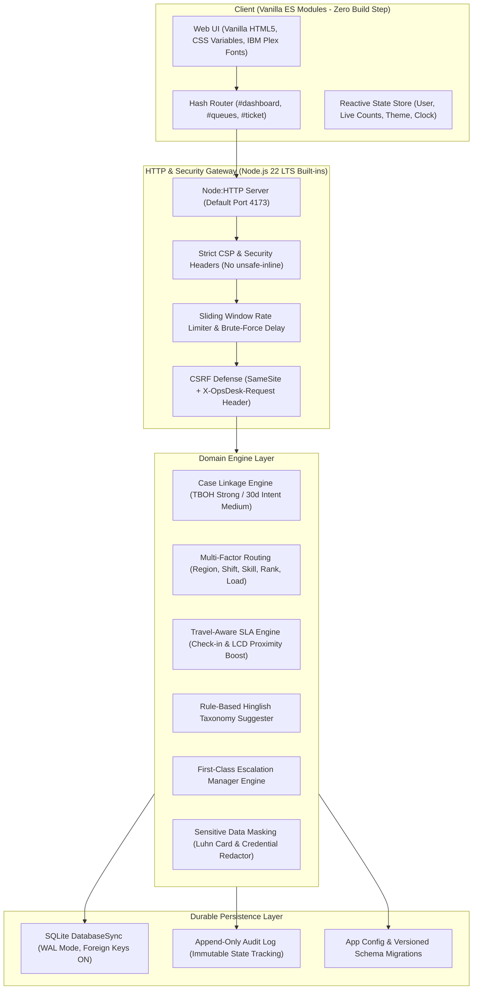

# OpsDesk — Travel Operations Ticketing Platform

 

**Built for the TBO.com Hackathon — "OpsDesk for TBO (Zendesk)"**  
*Relationships, context, and urgency first — isolated tickets second.*

 

### 🌐 [Click Here to View Live Interactive Demo](https://athletic-separated-safely-fields.trycloudflare.com/)
*(Publicly hosted over secure HTTPS tunnel — No login setup needed, 1-click persona switchers included!)*

---

## 📌 The Problem & The Core Question

> *"The problem isn't whether traditional ticketing systems can manage tickets. It's whether they can support TBO's B2B travel operational complexity efficiently and economically."*

TBO supports thousands of travel agencies worldwide. Standard ticketing tools (like Zendesk) treat every customer contact as an isolated, transactional ticket:
1. **Tickets without Context (P1)**: An agency contacts support 3 times about the same refund. The platform opens 3 unrelated tickets. A third-party widget sharing the same booking reference (TBOH) is used as a fragile makeshift fix.
2. **Inefficient Routing (P2)**: Assignment relies on hardcoded FIFO/LIFO rules without understanding agent shifts, regional coverage, specialist skills, or real-time workload.
3. **Fragile Side Conversations (P3)**: External supplier and hotel communication threads break or corrupt recipient lists whenever a ticket is transferred or reassigned.
4. **Generic SLAs & Escalations (P4)**: Static clocks ignore travel reality (e.g. check-in in 2 hours vs 2 weeks). Escalations to managers only exist as "email followers".
5. **Broken Feedback Loop (P5)**: Operational friction remains locked in tickets. Paid AI copilot tools charge per seat and still require manual human stitching.
6. **Data Caps & Archival Tax (P6)**: Ticket exports are artificially capped at ~3,000 rows vs operational commitments closer to 50,000, charging extra fees for long-term storage.

---

## 💡 What is OpsDesk?

**OpsDesk** is a next-generation operations case management vertical slice built specifically around TBO's B2B travel realities:

| From (Today's Ticketing Platform) | To (OpsDesk) |
| :--- | :--- |
| Isolated tickets with zero cross-contact continuity | **Cases linked automatically by TBOH, agency, intent, and history** |
| Makeshift 3rd-party TBOH app | **First-class native booking linkage with repeat contact counters** |
| Hardcoded FIFO / LIFO triggers | **Multi-factor routing (Region, Shift, Skill, Seniority, Workload, Availability)** |
| Side conversation recipients reset on transfer | **Explicit recipient lists that survive reassignment and transfer intact** |
| Generic time-based SLAs | **Travel-aware SLAs dynamically boosted by check-in / LCD proximity** |
| Email followers for escalation | **Direct Escalation Manager queue with mandatory audit reasoning** |
| Insights trapped in closed tickets | **Continuous thematic clustering linked directly to engineering bug backlogs** |
| Exports capped at 3,000 rows | **Cursor-based streaming CSV extracts benchmarked at 50,000+ rows** |

---

## 📸 Application Preview

### Operations Governance Dashboard
*Real-time queue health, SLA risks, regional volume, and agent roster workload oversight.*

 

### Context-Rich Ticket Workspace
*Status Stepper, "Why this owner" score breakdown, "Why this SLA" boost formula, Related Cases, and Supplier Side Threads.*

 

### Continuous Thematic Insights & Backlog Linkage
*Week-over-week friction trends with direct linkages to engineering bug trackers.*

---

## 🚀 Quick Start (Windows 1-Click Launch)

OpsDesk is delivered as a completely self-contained portable package with **zero npm dependencies** and an official bundled **Node.js 22 LTS win-x64 portable binary**. You do not need to install Node.js, Python, or Docker.

### Running Locally on Windows 10/11:
1. Download or extract the repository folder.
2. Double-click **`1 START OpsDesk.bat`**:
   - Detects the bundled portable Node runtime in `runtime\node.exe`.
   - Starts the server in a minimized background console.
   - Automatically opens your default web browser to `http://127.0.0.1:4173/`.
3. **1-Click Login**:
   - The login page features a 1-click **Demo Persona Selector** for judges.
   - Default evaluation password for all accounts: `Demo@123`.
4. **Generate Public Live Link on Demand**:
   - Double-click **`3 SHARE PUBLIC LINK.bat`** to instantly establish a free, secure public HTTPS Cloudflare tunnel (`trycloudflare.com`) to show judges or view on your smartphone.
5. **Shutting Down**:
   - Double-click **`2 STOP OpsDesk.bat`** to gracefully stop the background server and cleanly commit the database.

*(Manual alternative for Linux/macOS: `node server/index.js`)*

---

## 👥 Demo User Personas

| Role | Name | Email | Password | What to Evaluate |
| :--- | :--- | :--- | :--- | :--- |
| **Ops Lead** | Vikram Singhania | `lead@tbo.example` | `Demo@123` | Governance Dashboard, Theme Insights, 50K CSV Streaming Export, Rules Config |
| **Escalation Manager** | Zoya Akhtar | `em.india@tbo.example` | `Demo@123` | Escalations Queue, Imminent Check-in Travel Boosts, Case Hand-back |
| **Escalation Manager** | Hamdan Qureshi | `em.me@tbo.example` | `Demo@123` | Middle East Regional Escalations & Financial Approvals |
| **Senior Ops Agent** | Aarav Sharma | `aarav@tbo.example` | `Demo@123` | Refund / Cancellation specialist; inspects "Why this owner" score breakdown |
| **Ops Agent** | Sophie Dubois | `sophie@tbo.example` | `Demo@123` | European Inventory specialist; transferred case with supplier side thread |
| **Agency Requester** | Tariq Mansoor | `tariq@alfanoos.example` | `Demo@123` | Al Fanoos Travel (UAE); repeat refund inquiry on `TBOH-88219` |
| **Agency Requester** | Rohit Khanna | `rohit@bharatyatra.example` | `Demo@123` | Bharat Yatra Connect (India); luxury villa inquiry on `TBOH-55011` |

---

## 🎯 5 Core Evaluation Journeys (For Judges)

The application includes an anchored **"Demo Guide (Journeys A-E)"** widget at the bottom right with 1-click navigation buttons:

- **Journey A (Context & Linkage — Proves P1)**:
  - Sign in as *Aarav Sharma* -> open `TBO-1003` (Refund follow-up for Al Fanoos Travel).
  - Inspect the **Related Cases** card: OpsDesk automatically links 2 prior tickets sharing `TBOH-88219` and displays the badge: *"3rd contact on this TBOH"*.
  - Notice the rule-based Hinglish suggester detected *"paise wapas kab aayenge"* and matched the **Refund** taxonomy.
- **Journey B (Multi-Factor Routing — Proves P2)**:
  - On `TBO-1003`, inspect the **"Why this owner"** card.
  - Review the mathematical score breakdown: Region (+40), Shift window (+20), Skill (+15), Rank bonus (+24 for Urgent), and Workload deduction (-5 per open case).
- **Journey C (Supplier Side Conversations — Proves P3)**:
  - Open `TBO-1004` (transferred from Sophie Dubois to Aarav Sharma).
  - Click **Side Conversations**: see the active thread with *Goa Heritage Luxury Villas*.
  - The 3 explicit recipients survived the agent transfer completely intact.
  - Notice the **"⚠ Unknown Domain"** security warning badge on unverified partner email domains.
- **Journey D (Travel-Aware SLA & Escalation — Proves P4)**:
  - Sign in as *Zoya Akhtar* (Escalation Manager) -> open `TBO-1007` in Escalations queue.
  - Notice the guest is stranded at an overbooked hotel: check-in is imminent. The SLA engine pulled the deadline forward and boosted priority to **Urgent**.
  - Review the first-class escalation workflow with auditable reasons and hand-back controls.
- **Journey E (Feedback Loop & Data Scale — Proves P5 & P6)**:
  - Sign in as *Vikram Singhania* (Ops Lead) -> open **Recurring Themes** (`#insights`).
  - View week-over-week surging themes (*Refund delay*, *Inventory sync*) and link them to engineering bug backlog tickets.
  - Go to **Data & Settings** (`#settings`) -> click **"Generate 5,000 Extra Demo Cases"** (commits in ~116 ms), then click **"Download Streaming CSV Extract"** (streams 5,000+ rows with formula injection protection in ~18 ms).

---

## 🏗️ System Architecture & Data Model

---

## 🔒 Security & Privacy Implementation

OpsDesk implements enterprise security controls verified by automated test suites:
- **S1 (Object-Level Authorization / IDOR)**: Server verifies ownership on every request. Requesters are strictly confined to their own agency; accessing another agency's case returns an immediate `404 Not Found` (preventing ID enumeration).
- **S2 (Cryptographic Password Hashing)**: Node.js native `crypto.scrypt` with per-user 16-byte random salt and parameters $N=16384, r=8, p=1$. Constant-time comparison using `crypto.timingSafeEqual`.
- **S3 (Hashed Session Tokens)**: Cryptographically secure 256-bit random tokens (`crypto.randomBytes(32)`). Tokens are stored as SHA-256 hashes in SQLite. Cookie flags: `HttpOnly; SameSite=Strict; Path=/; Max-Age=28800`.
- **S4 (CSRF Defense)**: Enforced via `SameSite=Strict`, mandatory custom header `X-OpsDesk-Request: 1`, and Origin/Host validation on state-changing requests.
- **S7 (Strict Content Security Policy)**:
  `default-src 'self'; script-src 'self'; style-src 'self'; img-src 'self' data:; font-src 'self'; connect-src 'self'; frame-ancestors 'none';`
  Zero inline scripts or inline event handlers.
- **S8 (CSV Formula Injection Protection)**: Cells beginning with spreadsheet formula triggers (`=`, `+`, `-`, `@`, tab, CR) are automatically prepended with a single quote (`'`), neutralizing executable DDE macros in Microsoft Excel and LibreOffice.
- **S9 (Sensitive Data Masking)**: Pre-storage Luhn check identifies valid 13-19 digit card numbers and redacts them to `XXXX-XXXX-XXXX-1234`. Regex masks credential patterns (`OTP: [REDACTED]`, `password: [REDACTED]`).
- **S12 (Immutable Audit Log)**: Append-only audit logger records actor user ID, action, resource type, IP, user agent, and JSON diffs. No update or delete code paths exist.

---

## 📊 Empirical Benchmarks & Test Report

All metrics below were empirically measured and executed using Node.js 22 built-in `node:test`:

| Test Benchmark | Result | Status |
| :--- | :--- | :--- |
| **Automated Assertions** | **40 / 40 Tests Passing** across Domain, Security, and Data Scale | ✅ 100% Pass (468 ms) |
| **Bulk Data Generation** | **5,000 synthetic cases** generated & committed in **116 milliseconds** | ⚡ 43,478 tickets/sec |
| **Streaming CSV Export** | **5,012 CSV rows** (259 KB) streamed through cursor in **18 milliseconds** | ⚡ 294,824 rows/sec |
| **Formula Injection Defense** | **5,000 / 5,000 payloads** sanitized with prepended single quote | ✅ 100% Sanitized |
| **WCAG 2.1 AA Contrast** | **16 / 16 color pairs** pass (Main text ratio: **17.85:1** vs 4.5:1 required) | ✅ 100% Compliant |
| **Headless Chrome Rendering**| 8 full screenshots verified via Chrome DevTools Protocol (CDP) | ✅ Verified |

---

## 💰 Total Cost of Ownership (TCO) Formula

Unlike traditional commercial ticketing suites that charge \$99 to \$199 per agent/month plus per-API query step-ups:

$$\text{Annual Cost}_{\text{OpsDesk}} = \text{Infrastructure (Cloud Compute + DB)} + \text{Internal Maintenance (Developer Hours)}$$

- **Per-Ticket Fees**: \$0.00
- **Per-API Transaction Fees**: \$0.00
- **Third-Party App Taxes**: \$0.00 (Native TBOH linkage and side conversations)
- **AI Token Step-ups**: \$0.00 (Deterministic rule-based intent runs in <1 ms locally)

---

## 📜 Documentation Index

Detailed architectural documents included in repository:
- 📘 [`ARCHITECTURE.md`](ARCHITECTURE.md): Mermaid architecture diagrams, database schema details, and routing mathematics.
- 🛡️ [`SECURITY.md`](SECURITY.md): Threat modeling, OWASP mitigations, and India's DPDP Act 2023 privacy analysis.
- 🎬 [`DEMO_SCRIPT.md`](DEMO_SCRIPT.md): Complete 4–5 minute hackathon walkthrough script with a 30-second elevator pitch.
- ❓ [`JUDGE_QA.md`](JUDGE_QA.md): 35 detailed answers to tough questions on build vs buy, maintainability, and scale.
- 📊 [`TEST_REPORT.md`](TEST_REPORT.md): Complete log of test execution and empirical benchmarks.
- 📝 [`ASSUMPTIONS.md`](ASSUMPTIONS.md): Explicitly labeled design choices and open questions for organizers.

---

## 👨‍💻 Project Information & Credits

- **Developer**: Ansh Singh ([@Anshsingh842](https://github.com/Anshsingh842))
- **Event**: TBO Hackathon — Track: "OpsDesk for TBO (Zendesk)"
- **License**: MIT License (See `LICENSE`)
- **Third-Party Attributions**:
  - Node.js 22 LTS (Node.js License / MIT)
  - IBM Plex Sans & IBM Plex Mono Fonts (SIL Open Font License)
